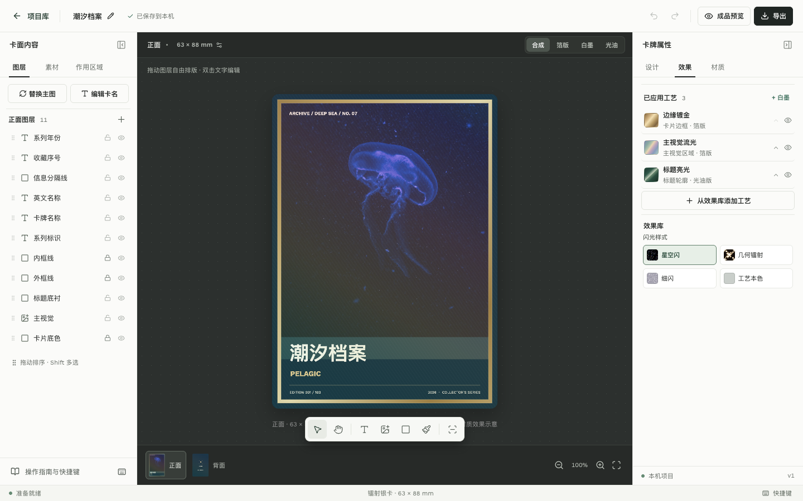

# Prism · 典藏卡编辑器

Prism 是一款本机制卡工具。创作者可以从模板或空白开始，编辑正反面图层，为指定区域叠加闪光、烫金、白墨或光油效果，再查看成品并导出。

## 界面预览



| 成品预览 | 印刷文件导出 |
| --- | --- |
| [查看闪光效果截图](docs/screenshots/preview.png) | [查看印前检查和技术打样文件截图](docs/screenshots/print.png) |

### 走一遍制卡流程

1. 在工作台的「最近项目」新建项目。先选卡基和底材反光，再选模板或空白卡面。
2. 在画布工具条添加图片、文字或形状。在「属性」里设定彩稿或工艺类型。右键可复制、粘贴、编组、设为蒙版、锁定和翻转。
3. 在彩稿蒙版内排版图文，或用文字、图形和图片细化工艺蒙版。白墨可直接上传 PNG，也可跟随彩稿图片的轮廓。局部闪光的样式、方向和强度在当前层的工艺属性中设置。
4. 在工作台查看通道合版或独立分版；打开「成品预览」，移动指针查看已应用的局部闪光。返回工作台后可下载数字图、可编辑项目包和技术打样包。打样包的 `layers/` 目录保留每层的独立 PDF 和 1 位 TIFF。

项目保存到本机 SQLite。关闭浏览器后，可以从「我的卡牌」继续编辑。印刷文件目前适合技术打样和印厂核对。

在画布上滚动鼠标滚轮，可以围绕指针缩放。按住空格拖动可平移画布，按 `0` 回到全览。

## 历史版本

`main` 用于持续开发。需要查看或运行某个版本时，可以打开对应的版本分支。

- [v0.3.0](https://github.com/mzh2775407121-netizen/prism-card-studio/tree/versions/v0.3.0) · 深色工作台和项目管理、正反面同画布、图层分组、画布内文字编辑和右键菜单。
- [v0.2.0](https://github.com/mzh2775407121-netizen/prism-card-studio/tree/versions/v0.2.0) · 增加工艺叠层和独立分版、可调圆角的印刷参考线，以及可自由平移、围绕指针缩放的画布。
- [v0.1.2](https://github.com/mzh2775407121-netizen/prism-card-studio/tree/versions/v0.1.2) · 增加 Mac 启动入口，修复直接打开 HTML 时的空白页。
- [v0.1.1](https://github.com/mzh2775407121-netizen/prism-card-studio/tree/versions/v0.1.1) · 统一 Prism 编辑器命名，迁移源码目录。
- [v0.1.0](https://github.com/mzh2775407121-netizen/prism-card-studio/tree/versions/v0.1.0) · 首次公开版本。

## 本机运行

Mac 上双击仓库根目录的「启动 Prism.command」。服务运行期间请保留终端窗口，编辑器会在浏览器中打开。首次运行需要安装下列依赖。

需要 Node.js 22、pnpm 和 Python 3.12。从仓库根目录执行以下命令。

```sh
cd editor
pnpm install --frozen-lockfile
pnpm build
python3 -m venv .venv
source .venv/bin/activate
python -m pip install -r requirements.txt
python server.py --data-dir .data
```

打开 [http://127.0.0.1:4174/](http://127.0.0.1:4174/)。按上述命令启动时，项目数据库在 `editor/.data/`。更多说明见 [运行和项目数据](editor/README.md)。图片、字体和卡册纹理的来源见 [素材来源](editor/public/assets/assets-sources.txt) 和 [卡册素材来源](editor/public/assets/album/来源.txt)。
